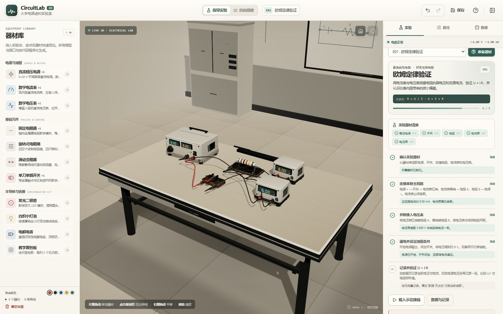
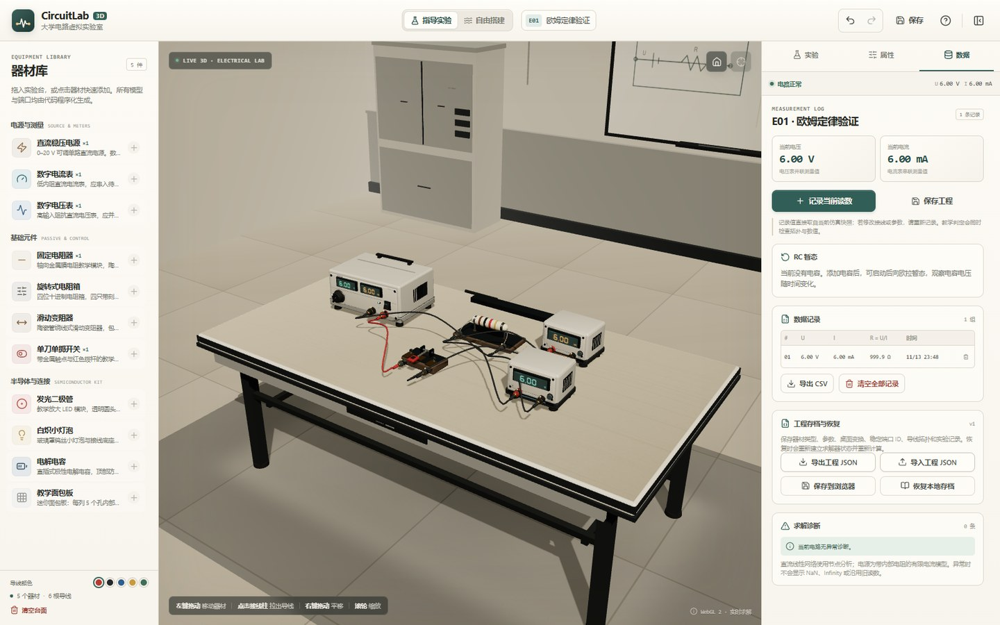
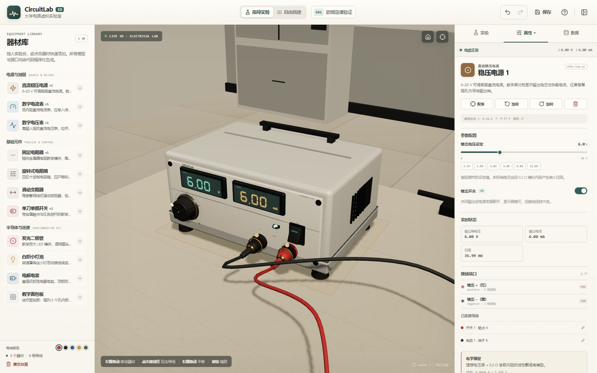
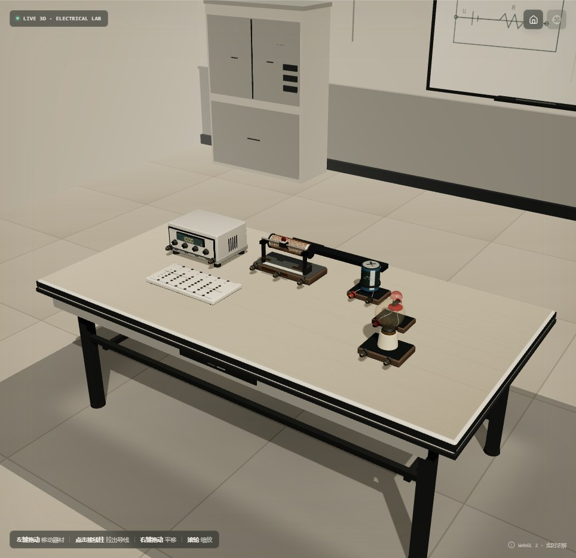
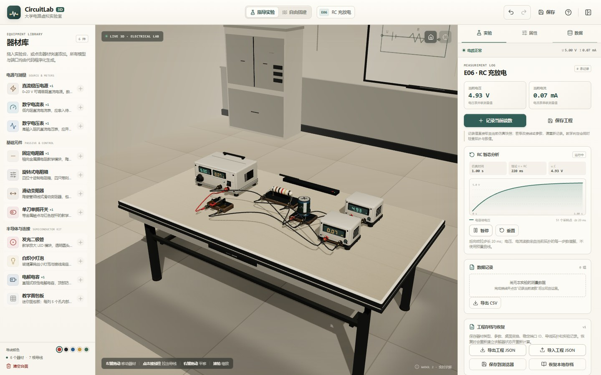
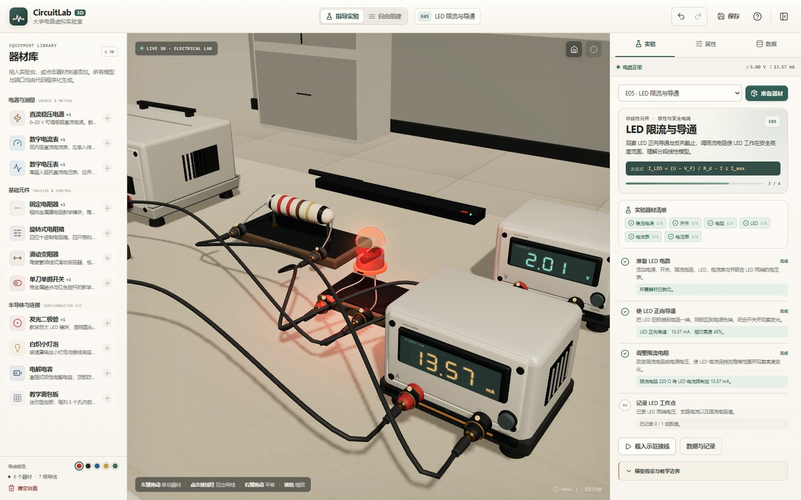
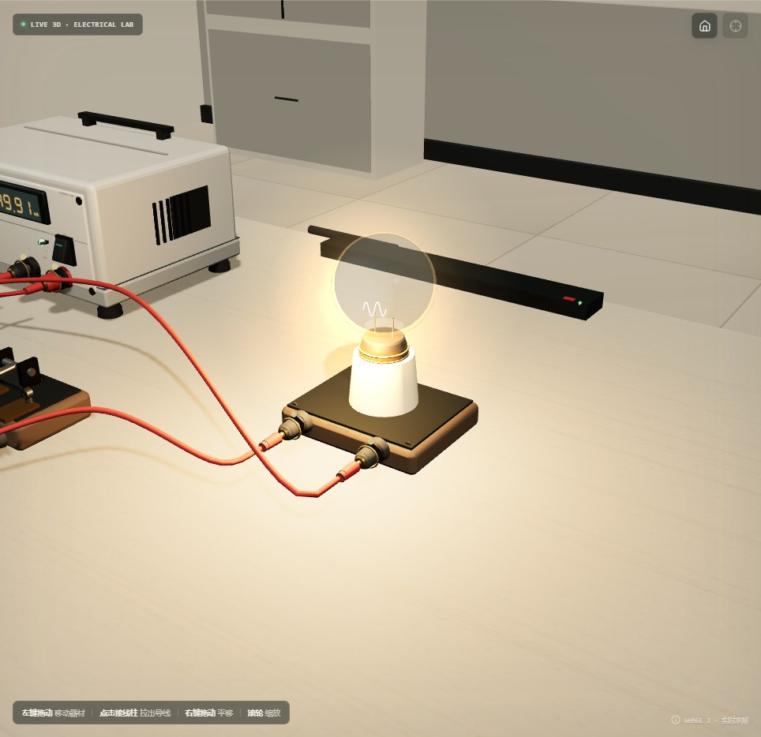
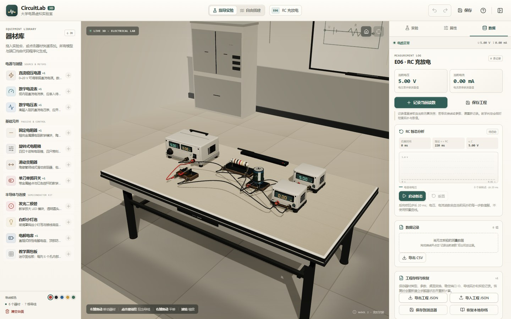
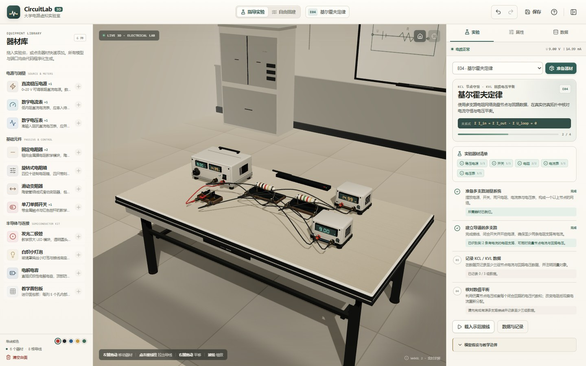

# CircuitLab-3D｜大学电路虚拟实验室

> **状态：可运行开发版本 `v0.2.0`**。在原有实现上新增三组大学电路实验、独立数值审计与网络等效分析，修复暂态调度和功率符号，完善按需渲染、自动取景及窄屏布局。当前仍是教学开发版本；完整范围和未完成项见 [本轮验收](docs/V0.2_VERIFICATION.md)。


本轮交付：**11 类程序化器材、9 组实验、62 项测试**。新增戴维南等效、叠加定理、最大功率传输；数据页显示真实网表的守恒残差、负载预测及功率匹配曲线。RC 按前台墙钟推进，积分 2 ms、采样 20 ms，支持电源置零放电和曲线 CSV。静止实验台停止连续重绘；相机可透视/顶视/前视，自动容纳多器材场景。

[研究与设计](docs/RESEARCH_AND_DESIGN.md) · [课程与科学约定](docs/CURRICULUM.md) · [v0.2 验收与限制](docs/V0.2_VERIFICATION.md)


## 项目定位

CircuitLab-3D 面向**大学电路基础教学**，不是二维原理图，也不是纯展示的三维模型。学生在可自由旋转的三维实验台上取用器材、移动旋转、插接导线、调节旋钮与开关，并观察由真实拓扑和数值计算驱动的仪表、LED、灯泡和 RC 曲线。

所有核心器材都由 Three.js **程序化建模**，不依赖 Blender 模型、GLB/FBX/OBJ、外部贴图或远程 3D 资产。实验界面使用 React DOM，三维交互使用 React Three Fiber；电气计算在纯 TypeScript 层独立完成。

## 当前可以做什么

- 从器材库拖入或点击添加：直流稳压电源、数字电流表、数字电压表、固定电阻、旋转式电阻箱、滑动变阻器、单刀单掷开关、电解电容、LED、小灯泡、面包板。
- 使用鼠标左键旋转/右键平移/滚轮缩放观察实验台；`Home` 恢复默认视角，`F` 聚焦选中器材。
- 拖动器材沿桌面移动，旋转（`R` / `Shift+R`），删除（`Delete`），调整参数；操作旋钮、摇板开关、十进制电阻箱旋钮或滑动变阻器滑片时有真实三维运动与数值反馈。
- 从任意接线柱按住拖出导线，实时预览弯曲路径与端口吸附；松开在有效端口上完成连接。移动器材时导线端点自动跟随。导线按唯一端口 ID 建立电气关系，空间相交不会隐式连接。
- 选中导线并拔除，或在属性面板中单独断开；支持每端口最多三根教学导线。
- 由电路拓扑自动构建网表，使用带有限内部电阻的电源模型和节点分析（MNA 的电流源/诺顿等效形式）求解稳态直流；随后由结果快照驱动数字仪表、LED、小灯泡和状态灯。
- LED 使用明确标注的**分段线性**模型；小灯泡使用线性冷态电阻 + 功率亮度映射；RC 电路使用**后向欧拉**暂态；所有模型假设在实验说明和属性面板中可见。
- 九组教学实验：欧姆定律、串联分压、并联分流、KCL/KVL、LED 限流、RC 充放电、戴维南等效、叠加定理、最大功率传输。步骤依据实际器材、网表和数值；新增网络实验要求记录不同工作点。
- 记录 U/I/R 数据、导出 CSV、导出/导入带版本的工程 JSON、保存到浏览器本地存储并刷新恢复。
- 操作历史支持撤销/重做；所有设备、导线、参数和场景布局都可恢复并重新求解。

## 界面与实验截图

| 欧姆定律实验接线 | 实验数据记录 |
| --- | --- |
|  |  |

| 直流电源局部特写 | 全部程序化器材 |
| --- | --- |
|  |  |

| RC 充放电暂态 | LED 限流点亮 |
| --- | --- |
|  |  |

| 小灯泡功率亮度 | 内置操作说明 |
| --- | --- |
|  |  |



*E04 示范采用两条真实并联支路：电源、开关、干路电流表、两只不同阻值电阻和并联电压表，接线与读数均由同一求解器生成。*

## 快速开始

环境要求：Node.js **>= 20.19**（建议 Node 22/24）与支持 WebGL 2 的现代桌面浏览器。

```bash
npm install
npm run dev
```

打开 <http://127.0.0.1:5173/>。

```bash
npm run typecheck   # TypeScript 严格类型检查
npm test            # 62 个仿真 / 教学 / 持久化测试
npm run build       # 生产构建到 dist/
npm run test:e2e    # 真实 Chrome：启动服务并执行浏览器验收（可自动启动 Vite）
npm run test:e2e:advanced # 九组实验 UI、功率调参、RC 放电/CSV、静止重绘、窄屏与焦点
```

两套浏览器测试默认在独立空闲端口启动当前检出的 Vite，避免误测已经运行的其他项目；使用系统 Chrome，不额外下载浏览器。也可通过 `CIRCUITLAB_URL` 指定当前服务，通过 `CHROME_PATH` 指定系统浏览器。测试证据输出到 `screenshots/`。

## 工程结构

```text
src/
  circuit/                 纯 TypeScript 电路域、目录、MNA 求解器与测试
    catalog.ts             器材尺寸、端口局部坐标、参数和默认值
    types.ts               Component / Port / Wire / Result 等稳定契约
    simulation/            节点分析、线性求解、诊断、非线性 LED、RC
  experiments/             教学实验定义、器材装配模板和步骤判定
  store/                   Zustand 状态、命令历史、自动保存、恢复
  three/
    instruments/           十一件器材的程序化几何模型
    WireSystem.tsx         曲线导线、插头、预览和选择
    parts.tsx              接线柱、旋钮、摇板、刻度等共享零件
    SceneEnvironment.tsx   实验桌、实验室空间与光照
    InteractionController  相机与器材操作输入仲裁
  ui/                      中文操作界面、器材库、属性/实验/数据面板
scripts/
  browser-check.mjs        真实浏览器验收脚本
docs/                      需求、架构、实验、验收与实现记录
```

## 仿真模型边界

| 项目 | 当前模型 |
| --- | --- |
| 直流线性网络 | 节点分析 / MNA；小规模高斯消元，部分主元与奇异矩阵诊断 |
| 直流电源 | 电压源 + 0.2 Ω 内部电阻（诺顿等效）；有限短路电流并产生告警 |
| 电阻 | 理想线性电阻，支持 1 Ω–1 MΩ |
| 开关 | 闭合 0.01 Ω，断开视为开路 |
| 电流表 | 0.1 Ω 串联采样电阻；量程与并联误接告警 |
| 电压表 | 10 MΩ 输入电阻 |
| LED | 分段线性：颜色对应阈值 Vf + 14 Ω 动态电阻；方向、限流与亮度由解算结果驱动 |
| 小灯泡 | 线性冷态电阻 + 功率—相对亮度映射；未建模钨丝热效应 |
| 电容 / RC | 直流开路；后向欧拉积分上限 2 ms，采样 20 ms；功率采用吸收为正，放电为负 |
| 滑动变阻器 | 三端线性电位器（A–W / W–B 两段电阻） |
| 面包板 | 42 孔教学板；每列 5 孔内部连通，两条电源轨纵向连通；内部按理想导体处理 |
| 导线 | 理想导体，视觉弯曲与实际电气拓扑分离 |

**明确未建模/未验证：** 交流、电感、二极管完整 Shockley 模型、电池老化、温度漂移、接触电阻、线缆电阻、真实短路保护、班级后台、多人协作、移动端触控布局，以及 Firefox/Safari 的实机兼容性。电流表/电压表采用教学用等效内阻，并非任何具体型号的校准数据。

## v0.1 历史验收结果（2026-11-13）

以下为上一版本记录，v0.2 的最新结果与截图见 [V0.2_VERIFICATION.md](docs/V0.2_VERIFICATION.md)。

- `npm run typecheck`：通过。
- `npm test`：4 个测试文件、**35 个测试全部通过**；覆盖欧姆定律、串并联、开路、短路、浮置网络、仪表负载、LED 正反向、RC 暂态、面包板内部连通、变阻器、教学实验装配/步骤判定与持久化校验。
- `npm run build`：通过；生产产物已生成。
- `npm run test:e2e`：真实 Chromium/Chrome 通过 3D 旋钮拖动、摇板开关、端口拖线、撤销/重做、6 组教学实验、欧姆定律数据记录（实测 R≈999.9 Ω，教学进度 5/5）、RC 充电、CSV 下载、帮助/自由模式切换和刷新恢复。
- GitHub Actions `CI`（commit `03deb33`）：在 Ubuntu / Node 22 上通过 `npm ci`、类型检查、35 个测试和生产构建。
- 测试环境使用 **ANGLE + SwiftShader（软件 WebGL 2）**，截图因此不代表独立显卡或集成显卡的帧率。硬件 GPU 性能尚未在本环境完成确认；初测渲染统计约 438 draw calls / 4.5 万三角面（默认场景），详见 [ACCEPTANCE.md](docs/ACCEPTANCE.md)。

## 文档导航

- [实现状态与模型边界](docs/IMPLEMENTATION_STATUS.md)
- [产品需求与功能范围](docs/PRODUCT_REQUIREMENTS.md)
- [技术架构与核心数据模型](docs/ARCHITECTURE.md)
- [分阶段开发路线图](docs/ROADMAP.md)
- [实验课程与器材规划](docs/EXPERIMENTS.md)
- [验收与测试证据](docs/ACCEPTANCE.md)
- [风险、边界与技术决策](docs/DECISIONS.md)
- [公开 3D 提示词研究](docs/AI_3D_PROMPT_RESEARCH.md)
- [AI 开发总提示词](prompts/MASTER_PROJECT_PROMPT.md)
- [单件实验仪器建模提示词](prompts/PROCEDURAL_INSTRUMENT_PROMPT.md)

## 设计原则

- **电学逻辑与网格解耦**：移动/删除 Three.js 对象不会直接改电气拓扑；唯一依据是 Component / Port / Wire 数据。
- **不伪造读数**：仪表、灯泡、LED 与曲线均由同一求解结果快照驱动；无解时显示诊断与空读数，不沿用旧值。
- **程序化建模**：模型、标签、刻度、材质和导线都由代码生成。
- **先可验证，再装饰**：优先保证拓扑、数值、交互和教学判定正确。
- **可复现**：工程 JSON 保存器材、参数、端口与布局；恢复时重新计算，不保存旧读数缓存。

---

当前版本是持续开发中的教学原型，不以生产级 SPICE 精度或完整 LMS 能力作宣称。实际已完成能力、验证证据和未完成项以 [IMPLEMENTATION_STATUS.md](docs/IMPLEMENTATION_STATUS.md) 与 [ACCEPTANCE.md](docs/ACCEPTANCE.md) 为准。
