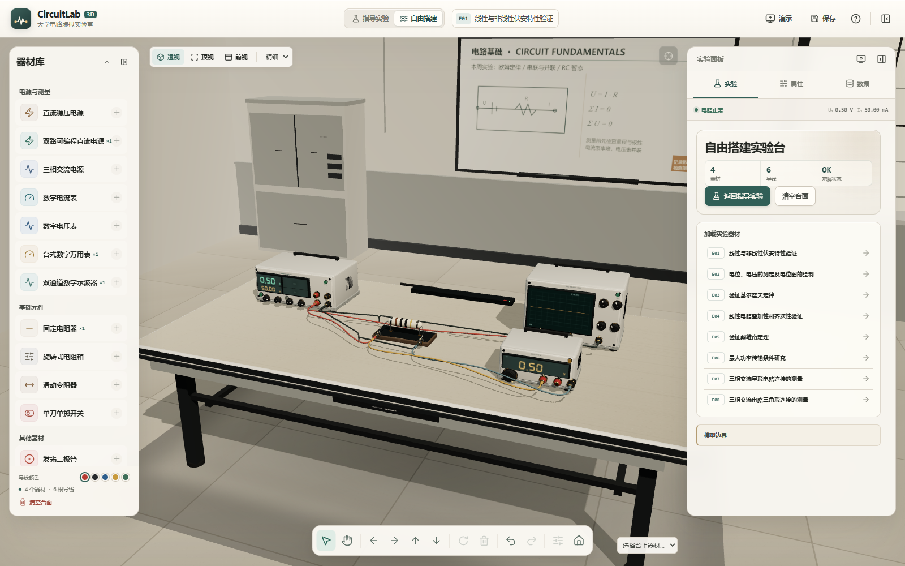

# CircuitLab-3D｜大学电路虚拟实验室

React、TypeScript、Three.js、React Three Fiber 与 WebGL 2 驱动的交互式实验台。房间、仪器、端口和导线全部通过代码建模，不使用现成三维模型。

当前开发版本 **v0.4.0** 按用户提供的八项课堂实验组织，加入浮动工作区、仪器控制台和数据大屏。尚未取得河北农业大学现用指导书、实验原理图和设备型号，因此不宣称复原该校现用装置。



## 课堂目录

| 实验 | 核心操作 |
| --- | --- |
| E01 线性与非线性伏安特性验证 | 对比电阻与小灯泡，调压、记录、绘制伏安曲线 |
| E02 电位、电压的测定及电位图的绘制 | 选择 A/B/C/D 参考点，记录电位，比较电压与电位图 |
| E03 验证基尔霍夫定律 | 测量支路电流与回路电压，核查有向代数和 |
| E04 线性电路叠加性和齐次性验证 | 电源单独/共同作用、两路同比变化与记录比较 |
| E05 验证戴维南定理 | 两负载伏安法估参，与开路/测试源分析比较 |
| E06 最大功率传输条件研究 | 改变负载，测量匹配点与两侧功率 |
| E07 三相交流星形电路连接的测量 | 对称/不对称负载，有中线/断中线及中点漂移 |
| E08 三相交流电路三角形连接的测量 | 比较线量与相量，检验对称条件下的 √3 关系 |

选择实验后只显示所需器材和对应测量面板。器材可移动、旋转、调参；接线使用实际端口 ID，空间交叉不连接。导线围绕机箱和接线柱寻路，移动其他器材也会重新规划。端口完全受阻时提示并暂隐受阻线，电气连接保留。

自由搭建保留 LED、面包板、RC 暂态等扩展能力；旧实验与工程文件仍可读取。课堂主目录固定为以上八项。

## 工作区与仪器

原有器材模型和课堂回路保留，补充三种程序化仪器：双路可编程直流电源、台式万用表和双通道示波器。它们可以从器材库添加；双击器材或选中后点击底部控制台按钮即可操作。两路源独立浮地并支持正向 CV/CC；万用表有独立 VΩ、A、COM 插孔；示波器两通道共用 COM，每通道 1 MΩ。

实验桌扩大为 2.8 × 1.4 m。三维画布铺满工作区，器材库可向上折叠或向侧边收起，右侧实验面板悬浮且可关闭。底部集中放置选择、平移、旋转、删除、撤销/重做、控制台和视角复位。平移移动相机与观察中心，不改变器材位置或当前观察方向。

原数据模块继续使用，顶部“演示”打开大屏，可全屏展示当前实验的图表、全部记录和 CSV 导出。控制台与大屏直接操作同一工程状态。

## 运行

需要 Node.js 20.19+。

```bash
npm ci
npm run dev
npm run check
npm run test:e2e
npm run test:e2e:advanced
npm run test:e2e:wires
npm run test:e2e:instruments
```

`test:e2e` 回归三维旋钮、开关、拖线、撤销、存档与旧实验；`test:e2e:advanced` 验收八项课堂流程、CSV、相量、实际三相源旋钮和 390 px 布局；`test:e2e:wires` 检查实际渲染导线与仪器三角网格。浏览器脚本自动启动独立本地端口，使用已安装的 Chrome；可用 `CHROME_PATH` 指定浏览器，或用 `CIRCUITLAB_URL` 指定开发地址。

本机已通过 140 项测试、类型检查与生产构建。八项课堂、真实三维交互、导线避障、仪器控制台与大屏分别有浏览器验收脚本；具体执行结果和范围见 [v0.4 验收](docs/V0.4_VERIFICATION.md) 与[八项课程验收](docs/COURSE_ALIGNMENT.md)。

生产预览：

```bash
npm run build
npm run preview -- --port 4175
```

## 仿真范围

- 直流由真实接线建立节点方程；电源、仪表内阻参与计算。LED 保留分段线性教学近似。
- 小灯泡为标定到额定工作点的稳态热电阻经验模型，体现非线性；没有热惯性、真实烧毁或实测灯泡标定。
- 三相采用独立的单频 RMS 相量求解；支持电阻负载、开关和 AC/DC 仪表，包含各相源内阻。默认 50 Hz、24 V 相电压。线量/相量关系按实际节点和支路计算，不将 √3 比例套用于不对称负载。
- 新双路源使用可收敛的正向恒流限制模型；反向灌电流会拒绝有效实验记录。万用表电阻挡只允许断电线性电阻网络；独立电流插孔的分流通路会影响实际电路。
- 示波器直流显示恒定电平，单频交流按 `u(t)=√2(Re(U)cosωt−Im(U)sinωt)` 还原；RC 只显示实际保存的节点采样。HOLD 在关闭/重开控制台后仍保持；重新载入工程会重置采集缓存，测量记录保留。
- 电位参考点只改变显示基准，不更改物理接线。电位图使用固定纵轴展示平移；测量记录保存当时的参考点、参数和数值。
- RC 在自由搭建中保留后向欧拉暂态。交流相量与时域暂态不混算。
- 没有完整 RLC/电机/变压器模型、线缆动力学、器材间碰撞、保护环和热损坏；未完成硬件 GPU 性能及 Safari/Firefox 实机验证。不是 SPICE 精度认证软件。

[v0.4 工作区与仪器验收](docs/V0.4_VERIFICATION.md) · [八项课程对齐](docs/COURSE_ALIGNMENT.md) · [科学约定](docs/CURRICULUM.md) · [研究与设计](docs/RESEARCH_AND_DESIGN.md) · [v0.2 历史验收](docs/V0.2_VERIFICATION.md)
