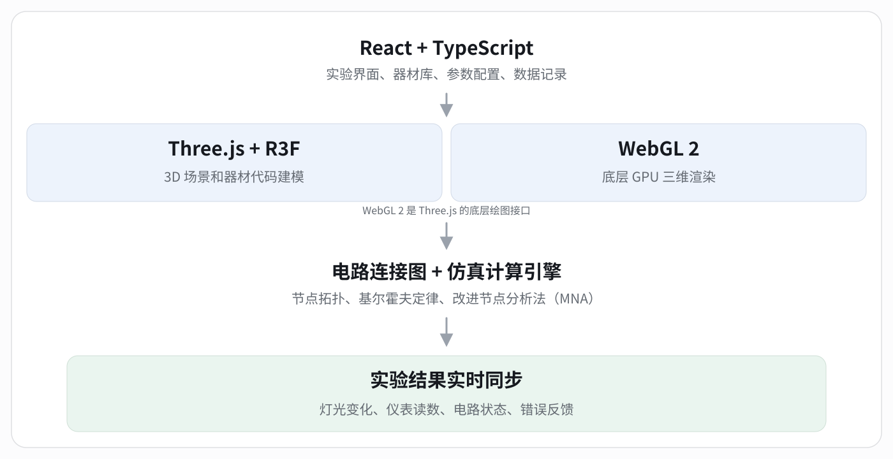

# CircuitLab-3D｜大学电路虚拟实验平台

> **项目状态：规划阶段（Planning Only）**。当前仓库仅保存产品设计、技术架构、开发路线图与验收要求，尚未开发或发布可运行的软件。

## 项目定位

CircuitLab-3D 旨在面向**大学电路基础教学**，建设基于浏览器的**真实实验室式三维电路实验平台**。学生不是在二维原理图里点击“仿真”，而是在可自由观察的三维实验台上选取仪器、移动器材、连接导线、调整参数、观察仪表读数并完成实验验证。既支持带步骤提示的教学实验，也支持自由搭建电路。

**模型制作原则：优先全部使用代码程序化建模**。通过 Three.js 中的几何体、曲线、程序化材质、CanvasTexture、几何组合等构造电源、电阻、电容、LED、小灯泡、开关、电表、面包板及接线端子；不以 Blender 制作的 GLB/FBX 模型作为首期必需资产。

**真实性分层：外观、交互和电学计算分别实现**。不能以 3D 动画假装电路计算，也不能把 Three.js 当成电路求解器。所有灯光、仪表读数和状态反馈都应由独立电路模型与仿真结果驱动。

## 目标能力

1. **代码生成 3D 器材**：真实外观、相对合理的尺寸、可识别正负极/接线孔、可调参数和可交互部件。
2. **三维实验操作**：鼠标旋转/缩放/平移视角，拖拽与旋转器材，导线端子吸附、插拔与改线，闭合开关和旋转旋钮。
3. **真实电路逻辑**：维护电气节点与元件拓扑，计算电压/电流等，识别常见开路、短路和串并联结构，区分模型能力与不可计算的场景。
4. **实时实验反馈**：灯泡/LED 按求解结果发光，电压表/电流表读数随接线和参数变化，异常接线有明确告警。
5. **简洁教学系统**：实验指导、步骤检查、数据记录、结果核验和自由搭建模式。

## 技术路线

| 层次 | 技术选择 | 职责 |
| --- | --- | --- |
| 页面与业务 | React + TypeScript | 实验界面、器材库、参数面板、教学步骤、记录与导入导出 |
| 三维场景 | Three.js + React Three Fiber（R3F） | 程序化模型、三维坐标、相机、拾取、拖拽、导线与材质表现 |
| 图形底层 | WebGL 2（由 Three.js 使用） | GPU 绘制；**不是与 Three.js 并列的独立业务模块** |
| 电路域模型 | 纯 TypeScript | 元件端口、导线、电气节点、连接关系、参数及校验 |
| 仿真引擎 | TypeScript + MNA（改进节点分析） | 先实现稳态直流线性电路；后续扩展非线性与暂态模型 |
| 状态同步 | 命令/事件 + 集中状态管理 | 实验动作 → 拓扑变化 → 重新求解 → 仪表/视觉/指导同步 |
| 数据存储 | 版本化 JSON + 浏览器本地存储 | 实验保存、恢复与数据记录；首期不依赖后端 |

架构参考图（依据原始截图重绘的矢量版）：

### 开发原则

- **先可用，再逼真**：先做通的实验流程与正确读数，再做高精度外观、特效与复杂器件。
- **先大学基础电路，再扩展电子技术**：第一阶段以直流电路、基础仪表为主；电容暂态、二极管非线性、交流等按阶段扩展。
- **电学逻辑不能绑定网格对象**：删除/移动三维 Mesh 不应改变已经定义的计算规则；计算的唯一依据是电气连接关系与器件参数。
- **实验数据可以复现**：同一实验文件和参数，应得出相同的理论计算结果；交互操作支持撤销和重做。
- **本仓库当前只存计划**：不提前生成空壳页面、模型代码或仿真 Demo，不把计划阶段表述为“功能已完成”。

## 文档导航

- [产品需求与功能范围](docs/PRODUCT_REQUIREMENTS.md)
- [技术架构与核心数据模型](docs/ARCHITECTURE.md)
- [分阶段开发路线图](docs/ROADMAP.md)
- [实验课程与器材规划](docs/EXPERIMENTS.md)
- [验收与测试标准](docs/ACCEPTANCE.md)
- [风险、边界与待定决策](docs/DECISIONS.md)
- [公开 3D 提示词研究与本项目写法](docs/AI_3D_PROMPT_RESEARCH.md)
- [AI 开发总提示词（未来开发时使用）](prompts/MASTER_PROJECT_PROMPT.md)
- [单件实验仪器程序化建模提示词](prompts/PROCEDURAL_INSTRUMENT_PROMPT.md)

## 当前阶段交付物

仅 Markdown 规划文件、AI 开发提示词与架构参考图片。**没有 `src/`、`package.json`、构建产物或在线体验入口**。

---

计划编制：2026-11-13。里程碑为实施顺序规划，不代表承诺完成日期。