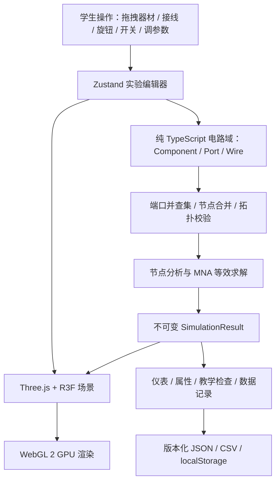

# 技术架构与实现说明

> 本文件由规划草案更新为 `v0.1.0` 的实际架构。电路计算、三维渲染、教学状态和持久化保持分离。

## 1. 总体架构



WebGL 2 是由 Three.js 使用的底层渲染 API，不是独立业务层。React DOM 负责表单、教学步骤、数据表格和设置；三维画布负责空间观察与操作。

## 2. 实际模块边界

| 模块 | 实际路径 | 职责 |
| --- | --- | --- |
| 应用层 | `src/App.tsx`, `src/ui/` | 布局、中文界面、器材库、属性/实验/数据面板、快捷键 |
| 三维场景 | `src/three/` | 程序化器材、桌面、实验室空间、相机、光照、端口拾取、导线 |
| 编辑器状态 | `src/store/labStore.ts` | 器材和导线状态、选择、拖动、参数、撤销/重做、自动保存、RC 运行时 |
| 器材元数据 | `src/circuit/catalog.ts` | 器材尺寸、几何端口坐标、参数定义、默认值、面包板内部组 |
| 电路域模型 | `src/circuit/types.ts` | Component / Port / Wire / SimulationResult / Diagnostic / 工程格式 |
| 网络与仿真 | `src/circuit/simulation/` | 端口中并查集、节点、独立网络接地、MNA 矩阵、高斯消元、LED 分段模型、RC |
| 教学实验 | `src/experiments/labs.ts` | 六组实验、器材布局、示范接线、按真实结果执行的步骤检查 |
| 持久化 | `src/store/persistence.ts` | schema v1 校验、localStorage、工程 JSON 数据 |
| 浏览器验收 | `scripts/browser-check.mjs` | 真实 Chrome 交互、数据、RC、帮助、恢复与截图 |

## 3. 核心领域模型

```ts
interface LabComponent {
  id: string;
  type: ComponentType;
  name: string;
  position: [number, number]; // 桌面 x/z，单位米
  rotationY: number;
  params: Record<string, number | string | boolean>;
}

interface PortDefinition {
  key: string;
  label: string;
  role: 'positive' | 'negative' | 'bidirectional' | 'anode' | 'cathode' | 'wiper' | 'hole';
  position: [number, number, number];
  normal?: [number, number, number];
}

interface Wire {
  id: string;
  fromPortId: string; // `${componentId}:${portKey}`
  toPortId: string;
  color: string;
}
```

- 器材类型、参数 schema、端口坐标与默认值统一放在 `catalog.ts`。
- 完整端口 ID 稳定且不依赖 3D 对象引用；器材移动只改变变换，不改变 ID。
- 面包板内部连通组由 `getInternalPortGroups()` 提供，进入相同的并查集合并流程。
- 变换辅助函数 `getPortWorldPosition()` / `getPortWorldNormal()` 在电路目录与导线渲染间共享坐标定义。

## 4. 从操作到读数的单向数据流

1. 用户 pointerdown 命中端口拾取体（独立透明命中几何），调用 `beginWire(portId)`。
2. 指针移动期间 `InteractionController` 使用端口注册表和桌面平面更新导线预览；有效目标显示吸附环。
3. pointerup 在目标端口完成时提交 `Wire`，Zustand 记录历史并调用 `simulateCircuit`。
4. `simulateCircuit` 用并查集合并导线与面包板内部组，选择独立参考地，组装节点方程。
5. 求解结果是一个不可变 `SimulationResult`，包括节点电压、元件电流/电压/功率、仪表读数、亮度、诊断和求解状态。
6. 所有三维数字屏、LED、灯泡、模拟指针/开关状态与教学检查均读取该结果快照。
7. 数据记录直接复制当前快照读数，恢复工作区后重新求解，不读取旧缓存数值。

## 5. 仿真器实现

### 5.1 节点分析

电流表/电压表采用有限内阻；电源采用带 0.2 Ω 内部电阻的诺顿等效，即电流源与内部电导并联。这样直接短路时也能得到有限电流，并将“短路/接近短路”作为诊断返回，避免理想电压源造成的矩阵奇异。

为稳定处理孤立器材和未接电源的网络，每个物理连通子网络单独选取参考地。电源负端优先作为地。求解矩阵为小规模稠密矩阵，采用部分主元高斯消元和主元阈值判断。

### 5.2 非线性 LED

LED 使用明确的教学分段模型：

- 正向：`I = max(0, (U - Vf) / Rd)`，`Vf` 由颜色决定，`Rd ≈ 14 Ω`。
- 反向/低于阈值：高阻漏电模型。
- 求解使用主动集迭代；网络复杂时最多枚举 2^N 个 LED 通断状态。未收敛会返回错误，而不是给出猜测值。
- 亮度 `I / I_max` 驱动封装自发光和柔和光晕；不是固定动画。

### 5.3 小灯泡

线性冷态电阻 `R` 计算功率，亮度映射为 `clamp(P / P_rated, 0, 1.5)`。明确未建模钨丝热效应导致的电阻变化。

### 5.4 RC 暂态

后向欧拉伴随模型：`G = C / dt`、等效电流源 `G · u_prev`。每一步重新组装网络并求解，电容电压状态仅从上一步的解推进。暂停/继续/重置由 store 运行时控制，曲线使用仿真时间。

## 6. 三维实现

- 每件器材由独立 Group、多个有厚度和局部坐标的零件构成，避免整体方块替代。
- 复用材质与共享小零件几何，统一 `MeshStandardMaterial` / `MeshPhysicalMaterial` 语义。
- 端口视觉与电气位置使用同一局部坐标定义；插头方向由端口法线决定。
- 导线使用 CatmullRomCurve3 + TubeGeometry，两端插头独立建模；预览使用 Drei Line。
- 选中轮廓与标签等装饰物禁用 raycast，避免遮挡控件输入。
- 实验桌、墙面、地板和仪器使用方向光阴影、环境 Lightformer、柔和接触阴影。

## 7. 状态与命令历史

- Zustand store 是唯一业务状态源；三维对象和 React 面板都订阅相同的器材/导线/结果状态。
- 快照历史保存电路快照（器材、参数、变换、导线），时间线最多 60 步。
- 拖动和旋钮连续操作使用事务：开始时保存 before 快照，结束时提交一次撤销节点。
- 防抖自动保存到 localStorage；用户也可导出/导入版本化 JSON。
- 面板输入与三维控件调用相同 action，不存在两套参数来源。

## 8. 测试分层

- **领域/算法**：Vitest 纯 TypeScript 测试，不依赖浏览器或 Three.js。
- **教学装配**：对六组模板进行真实模拟和步骤检查。
- **持久化**：schema 往返、非法结构、非法导线拒绝。
- **浏览器**：系统 Chrome 下真实鼠标拖动旋钮/端口、撤销重做、数据记录、RC、下载、帮助和刷新恢复。
- **视觉 QA**：多角度截图并人工检查比例、光照、阴影、接线与 UI 遮挡。

## 9. 性能策略

- R3F Canvas 的 DPR 上限 1.75；阴影贴图 2048；单方向光投影。
- 共享材质和小零件几何；静态环境贴图；避免每帧重建网表。
- 求解只在电路状态变化或 RC 定时推进时发生，不在普通渲染帧无条件调用。
- 当前软件渲染环境无法评估集成显卡 FPS；硬件实测列为未完成项。

## 10. 已知架构边界

- 交流、电感和完整非线性器件不在当前求解范围。
- 导线电阻与接触电阻忽略；电源无主动恒流/截止保护。
- 面包板为 42 孔教学模型，非标准全尺寸板。
- 3D 拾取没有完整遮挡深度排序；极端重叠器材下端口可能被优先选中。
- 暂态定时器不是基于真实 elapsed time 的累加器；低帧率时仿真时间会慢于墙钟。
