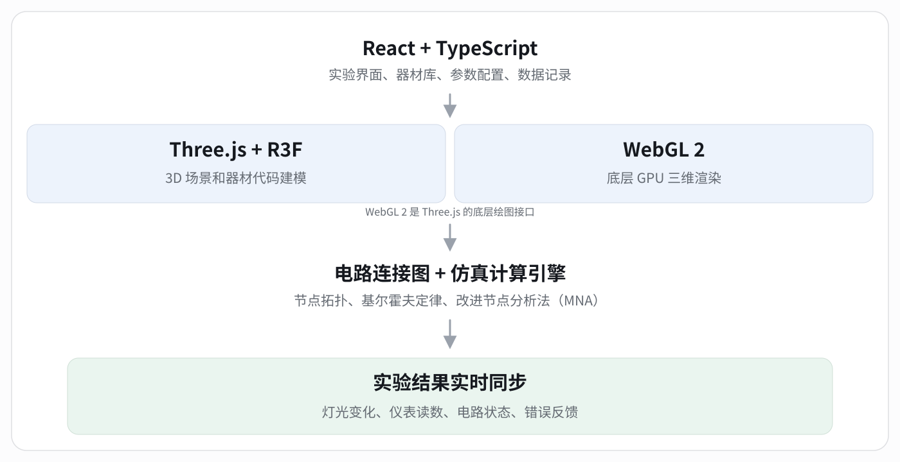

# 技术架构与数据流（设计草案）

## 1. 总体架构

遵循用户提供的结构，React + TypeScript 提供实验 UI；Three.js + React Three Fiber 实现三维场景；WebGL 2 作为底层渲染 API；电路图与仿真计算层独立于视觉组件；实验结果同步回三维视图、仪表和教学状态。

> 重要纠偏：**WebGL 2 位于 Three.js 的底层，不与 Three.js 并列负责业务三维场景**。R3F 是 React 对 Three.js 场景的声明式封装，不是第二套渲染引擎。

~~~mermaid
flowchart TD
    U[用户：拖拽器材／连线／调参数／切换开关] --> CMD[React + TypeScript 编辑命令]
    CMD --> DOMAIN[独立电路域模型：元件、端口、导线、拓扑]
    CMD --> VIEW[Three.js + R3F：场景、器材、相机、导线]
    VIEW --> GL[WebGL 2：GPU 渲染]
    DOMAIN --> VAL[拓扑校验／节点合并／异常检测]
    VAL --> MNA[仿真引擎：MNA 直流求解]
    MNA --> RESULT[结果快照：节点电压、支路电流、异常]
    RESULT --> VIEW
    RESULT --> UI[React：仪表、教学、数据记录]
    UI --> SAVE[版本化实验 JSON / CSV]
~~~

用户原始示意图：

## 2. 拟定模块边界

| 模块 | 主要职责 | 禁止承担的职责 |
| --- | --- | --- |
| `app`（未来） | 路由、页面组织、状态容器 | 直接写求解公式 |
| `scene`（未来） | 三维程序化建模、材质、相机、拾取 | 将 Mesh 位置当作电路连接关系 |
| `editor`（未来） | 器材放置、选择、连线命令、撤销重做 | 自行计算电流值 |
| `circuit-core`（未来） | 组件/端口/导线、电气拓扑、参数、约束 | 依赖 Three.js 或 React |
| `simulator`（未来） | MNA 组装、线性求解、错误诊断 | 控制页面 UI 或直接更改器材 Mesh |
| `experiments`（未来） | 教学目标、检查规则、记录导出 | 重写独立电路计算 |
| `persistence`（未来） | JSON 保存/恢复、格式迁移 | 保存无法复原的三维实例对象 |

本文件里的目录名称均是**未来设计建议**，当前不创建功能模块。

## 3. 核心领域数据模型（概念，不是实现代码）

- **Component（元件）**：稳定唯一 ID、器材类型、参数、元件版本号；可关联三维实体。
- **Port（端口）**：稳定 ID、所属元件 ID、局部坐标、连接限制、正/负极或测量口语义。
- **Wire（导线）**：端点端口 ID、路径控制点/视觉颜色；电气连接只认端口 ID，不凭网格相交。
- **Node（电气节点）**：由导线连通关系合并而成的等电位节点；可通过并查集等方式构建。
- **SceneTransform（摆放）**：器材在工作台上的位置与朝向，独立于 Component 的电气属性。
- **SimulationResult（求解结果）**：节点电压、支路电流、器材功率、解算状态、诊断与版本号。
- **Experiment（教学实验）**：目标、器材要求、接线检查规则、测量点、步骤、评分/提示规则（首期只做本地验证）。

需要保持 **Domain ID → View ID** 的稳定映射，场景重绘不影响电气拓扑，拖拽仅改变变换矩阵，连接/断开动作才改变图结构。

## 4. 从“接线”到“发光”的单向数据流

1. 鼠标点击三维端子，通过 Raycaster 等命中对应 Port ID。
2. 拖线到另一个端子，编辑器验证接线操作并提交命令。
3. 更新 Wire 集合，重新构建或增量更新电气节点。
4. 进行网络拓扑预检查（悬空、短路、端口类型、非法数值）。
5. 将拓扑转换为求解器网表，执行直流计算；异常时返回诊断而不是数字。
6. 发出不可变的结果快照：电流、电压、功率、故障状态。
7. 电表、指示灯、端子高亮、教学检查与记录面板订阅同一结果快照。

对于密集操作，可批处理或节流求解；如主线程受阻，再考虑 Web Worker，避免在第一阶段过度复杂化。

## 5. 仿真引擎分层实施

### 第一层：直流线性稳态（最先实现）

支持固定电阻、独立直流电源（必要时设内阻或限流）、开关、导线、电压表和电流表的等效电路。以 MNA 组装线性方程，计算节点电压和电压源支路电流，进一步得到电阻电流及功率。对理想电源短接、浮置节点和奇异方程提供可靠诊断。

**精度要求：** 与解析解一致，使用可配置容差；近似模拟不能掩盖错误接线。电压表应采用高输入电阻模型、电流表应采用低但非零内阻模型，避免数值病态和不合理无穷大。

### 第二层：非线性器件

LED 需正向压降及非线性导通模型；可采用简化分段模型作为教学演示，之后升级迭代数值求解（如牛顿迭代），并对收敛失败做明确反馈。灯泡可先将亮度关联耗散功率，再逐步研究热阻变化。**不得把电压到颜色/亮度的固定映射称作完整电路仿真。**

### 第三层：时间相关及扩展

电容充放电、RC 暂态，按数值积分离散方程实现；交流、感性元件、示波器、复杂非线性与 SPICE 兼容层均属于后续阶段，独立评估成本与误差。

## 6. 3D 代码建模约定

- 使用 Three.js 几何体组合生成壳体、端子、旋钮、刻度与标识；统一世界坐标和单位换算规范。
- 元件使用统一尺寸基准，端子局部坐标与展示几何同源，旋转/拖拽后经矩阵换算获取世界坐标。
- 导线使用可弯曲路径和管状几何生成，起点与终点绑定端口，元件移动时可更新曲线。
- 视觉材质区分金属、塑料、玻璃、发光面；发光强度由 SimulationResult 控制。
- 支持必要的 Level-of-Detail、InstancedMesh 或几何缓存优化，但不把优化工作提前于正确交互实现。
- 相机操作与元件操作要有输入仲裁，不允许拖导线时相机同步旋转。

## 7. 数据保存与复现

计划以版本化 JSON 保存器材定义（type + params）、三维变换、Port ID、导线端点和实验记录；不序列化 Three.js 对象或运行时求解矩阵。载入时首先校验 schema，恢复模型并重新求解，保证结果由保存的电路状态计算得到，而非仅恢复旧读数。

## 8. 测试分层

纯算法单元测试（无浏览器依赖）→ 元件/连线状态机测试 → React/R3F 交互测试 → 浏览器端端到端实验测试。基于标准电路解析解建立回归测试，记录近似器件的物理假设及允许误差。