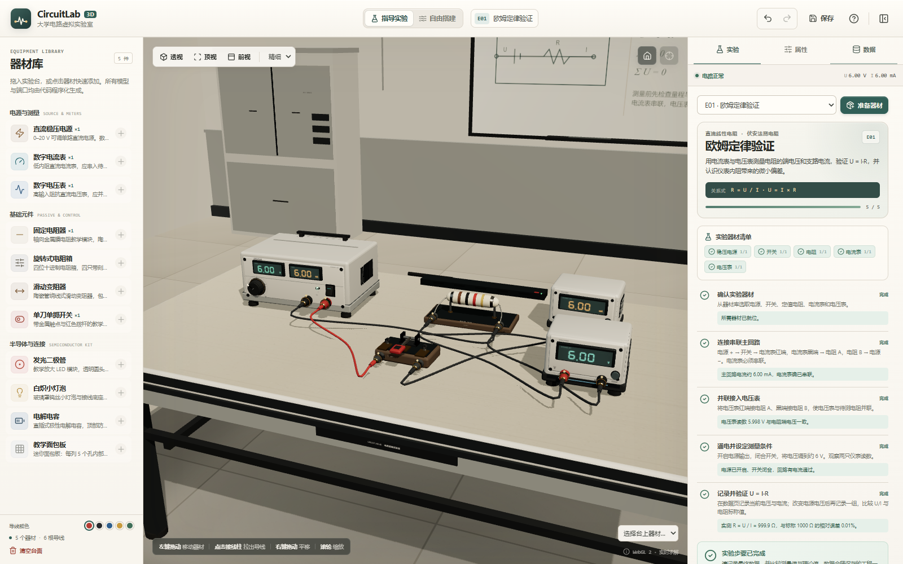
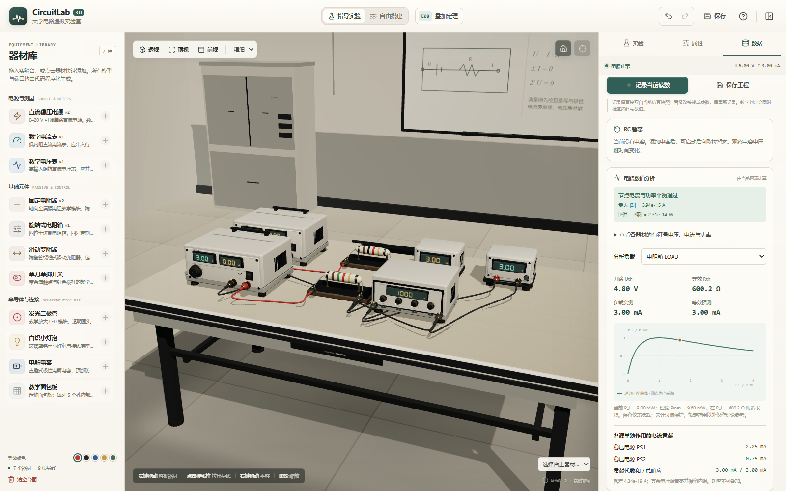
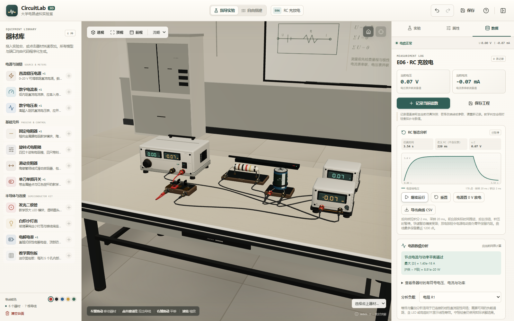
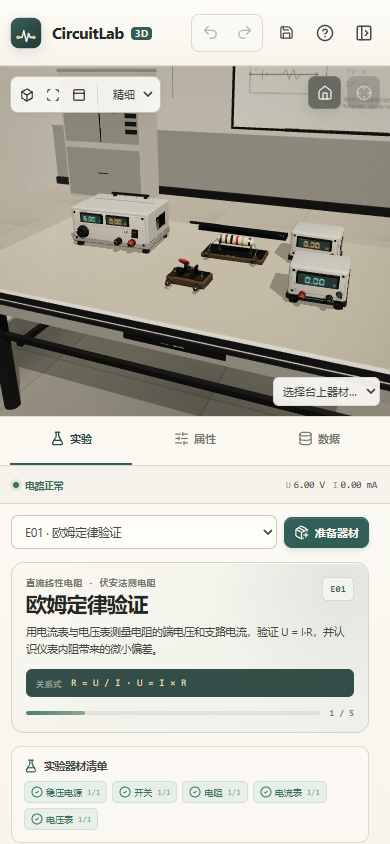

# v0.2.0 交付与验收

日期：2026-11-14（Asia/Shanghai）。本轮在原有 v0.1.0 上开发，分支 `feat/teaching-fidelity-v0.2`。本文件区分实际运行证据和仍未完成的目标。

## 导线穿模修复（2026-11-14）

- 导线围绕包含接线柱突出部分的旋转机箱包围盒寻路，优先从桌面绕行，无通路时尝试上方路径；圆角也检查间隙。已连接线、预览线和选择区域使用相同路线。移动未接线的第三件器材同样触发重算，纯电气参数变化复用路线。
- 完全遮住端口时显示出线空间不足提示，暂不绘制受阻线，原有电气连接保留；移开遮挡自动恢复。叠加实验的第二电源后移 4 cm，留出堆叠插头空间。
- 修复顶视时被房间顶板遮挡的问题：室内天花板使用单面平面，顶视从外侧可见实验台。
- `npm run check` 通过：严格类型检查、**7 个文件 / 82 项测试**、生产构建。新增 20 项覆盖旋转、第三件器材、桌面堵塞、面包板跳线、三层插头、受阻端口及九组示范。
- Chrome / SwiftShader 执行 `npm run test:e2e:wires` 通过：九组共 **68 根**实际渲染导线，用管线采样及半径偏移线段检测实际仪器三角网格，未检测到相交。真实鼠标移动、键盘旋转未接线电阻箱后路线改变且无相交；读数保持一致，遮挡提示及恢复通过，浏览器错误为 0。
- 此检查结合 1 mm 间隔的数值抽样与截图检查，不是任意布局的严格几何证明，也不是线缆动力学。器材仍可相互重叠；没有线与线碰撞、线长/拉力或硬件 GPU 性能验证。

检查证据：[机器记录](media/wire-fix-evidence.json)、[透视截图](media/wire-fix-perspective.png)、[顶视截图](media/wire-fix-top.png)。本机生产预览已重新构建，并在现有 E04 工作区检查透视/顶视、仪表读数及流畅画质；保留 6 件器材与 8 根连接。

## 已交付

### 界面精简（2026-11-14）

移除器材卡片长描述、英文副标题、常驻操作条、WebGL 标签、属性面板内部 ID/坐标和重复参数说明。教学步骤默认展开当前未完成的一步，其余可展开；电学模型折叠查看。没有电容时不显示 RC 卡片，没有异常时不显示诊断卡片。单位、有效范围、科学模型边界与异常提示保留。

严格类型检查及生产构建通过；精简后 `npm run test:e2e:advanced` 通过九组实验、参数、RC/CSV、静止重绘、焦点和 390 px 窄屏，错误为 0。生产页面另检查了步骤展开、属性/数据面板及滚动恢复：数据页滚动 376 px 后选中器材，属性面板回到 0 px，标题可见。

证据：[桌面](media/ui-clean-desktop.png)、[窄屏](media/ui-clean-mobile.png)、[机器记录](media/ui-clean-evidence.json)。

### v0.2 基础能力

- 保留 React、TypeScript、Three.js、React Three Fiber、WebGL 2 技术栈；11 类器材、实验桌和房间仍全部程序化生成，没有 GLB/FBX/OBJ 或远程模型依赖。
- 新增 E07 戴维南等效、E08 叠加定理、E09 最大功率传输，总计九组教学实验；新增实验包含真实接线模板、学习目标、模型说明及不同工作点的记录判定。
- 独立纯 TypeScript 分析模块：按真实网表计算节点 KCL 残差、功率平衡、开路电压、测试源等效电阻、负载预测及各源电流贡献。含非线性 LED/电容时拒绝线性等效，不改变用户现场接线。
- 修复 RC 每 50 ms 只推进 20 ms 的调度：前台固定采样时钟 + 2 ms 后向欧拉子步；后台冻结，明显积压时暂停。支持电源置 0 V 放电、曲线 CSV、滚动时间轴。
- 修复变阻器只计算 A–W 一段功率、电容放电功率被取绝对值、蓝色 LED 安全电流阈值不匹配，以及存档重复 ID 检查无效的问题。超量程和错误状态不能作为有效测量记录。
- 按需渲染，机械/亮度/相机动画收敛后休眠；静态房间几何合批；精细/流畅画质。
- 透视/顶视/前视镜头按实际器材包围盒与视口自动取景；导线下垂、同端口插头分层堆叠，降低仪表遮挡。
- DOM 器材选择、帮助窗口焦点约束和恢复、390 px 上下布局、窄屏默认收起器材库。
- 两套浏览器测试默认自动启动当前检出的独立端口；CI 增加浏览器验收与证据上传。

## 本机实际执行

| 检查 | 实际结果 |
| --- | --- |
| `npm run typecheck` | 通过 |
| `npm test` | 6 个文件，**62 项通过** |
| `npm run build` | 通过，Vite 生成生产构建 |
| `npm run test:e2e` | 系统 Chrome / SwiftShader，通过；自动创建独立 Vite 端口 |
| `npm run test:e2e:advanced` | 系统 Chrome / SwiftShader，通过；九组实验 UI、负载调参、暂态/CSV、焦点和窄屏 |
| `git diff --check` | 通过 |

单元/集成覆盖：原有直流、短路、开路、LED、面包板、变阻器与存档；新增戴维南解析值、五个不同负载、最大功率两侧验证、叠加响应与功率不可叠加、拒绝非线性等效、伪造读数的守恒拒绝、变阻器三端功率、RC 解析充放电/步长收敛、调度积压、超量程记录、真实端口与重复 ID/导线。

### 可核对的数值

- 欧姆定律示范：电流表 **5.998740 mA**，电压表 **5.998140 V**，U/I≈**999.900 Ω**；教学 **5/5**。
- 双源示范：Uth≈**4.80 V**、Rth≈**600.2 Ω**；单独电流贡献约 **2.25 mA + 0.75 mA = 3.00 mA**。精确求解叠加残差约 10⁻¹⁹ A。
- 最大功率实验：通过属性面板将负载分别设为 **100、500、2000 Ω** 并记录，返回 **500 Ω** 时教学 **3/3**；负载功率与等效理论一致。
- RC 基础回归：3.20 s 仿真时间、161 点，电容约 **4.999497 V**。高级检查某次运行前台墙钟 **2.574 s**、仿真 **2.600 s**；暂停后时钟保持不变。导出 **131** 行电压采样；放电后电容约 **0.07113 V**、端口功率为负。浏览器负载不同会改变点击时刻和采样数量，不要求每次固定同一数量。
- 静止默认实验台：渲染 frame **31 → 31**，500 ms 检查期间无新帧；默认约 **392 draw calls / 44,698 triangles**。原 v0.1 文档记录约 438 calls，但镜头也有变化，不把两者当作严格受控性能基准。

机器可读浏览器记录：[v0.2-browser-evidence.json](v0.2-browser-evidence.json)。其中 GPU 为 **ANGLE / SwiftShader 软件 WebGL 2**。脚本里的浏览器 requestAnimationFrame 频率不是场景实际重绘 FPS，不用于宣称 GPU 性能。

### 真实三维交互

实际鼠标拖动电源旋钮使电压 **6.0 → 11.5 V**，器材未随旋钮移动；实际点击三维摇板关闭并恢复电源；实际从端子拖出导线新增一根，撤销/重做正确；示范接线、数据记录、工作区刷新恢复与 CSV 下载通过。九组实验全部由同一求解器计算，浏览器未出现运行异常或 WebGL context lost。

## 视觉检查与修复台账

先用内置浏览器研究三维作品；内置浏览器无法连接 Windows 的沙箱内 localhost 后，改用本机可访问的 Vite 服务与 Chrome，通过 CUA 检查，并使用仓库 Playwright 测试生成可保存截图。设计参考和最终截图均用 `view_image` 实际查看。桌面检查 1600×1000；窄屏检查 390×844。生产构建另在参考图原生尺寸 **1586×992** 验证：无外部资源请求、无运行异常、不暴露 `window.__circuitlab` 开发接口，戴维南 Uth≈5.00 V、Rth≈500.1 Ω，实测与预测均约 5.00 mA。

生产原生尺寸截图：[v0.2-production-native.png](media/v0.2-production-native.png)。

### 远端 CI 记录

[首次 v0.2 CI](https://github.com/JmCake/CircuitLab-3D/actions/runs/43465725268) 在 Ubuntu / Node 22 上通过类型检查、62 项测试、构建及两套浏览器测试。浏览器验收的最大功率进度 3/3、九组实际接线、静止不重绘、放电、CSV、焦点与窄屏全部通过；最终工作流因 **GitHub Actions Artifact 存储配额已满** 而标记失败，并非测试失败。

后续将截图上传步骤设为可选，保留全部测试为必过项，并将新产物保留期设为三天。没有删除已有远端产物。已提交的本机截图和 JSON 证据可直接查阅。远端软件渲染负载较高时，基础 RC 测试观察到保护性暂停；高级测试切换流畅画质后墙钟 10.695 s、仿真 10.580 s，误差约 0.115 s，530 行 CSV，放电后约 3.82 nV。

| 对照点 | 发现的问题 | 已做修复 / 实际差异 |
| --- | --- | --- |
| 镜头与构图 | 初始器材偏小；固定近镜头裁切双电源实验 | 根据器材与视口计算镜头距离；恢复/三种视图均适配 |
| 导线与仪表 | 高拱形导线遮挡数字屏 | 导线中段落向桌面；同一端口多个插头沿法线堆叠 |
| 阴影 | 较大软阴影、较少采样造成明显噪点 | 缩小阴影尺寸、增加采样；流畅模式可关闭实时阴影 |
| 界面结构与字体 | 新控制可能挤占工作区 | 延续原三栏结构、暖色面板、松绿操作、lucide 图标与本地字体；紧凑视图工具栏 |
| 科学文案 | 生成参考存在量程、接线和读数错误 | 保留 0–20 V 与真实约 6 mA；教学进度由实际记录驱动，修正 LED 公式和 RC 边界 |
| 窄屏 | 原三栏挤压三维区，器材库覆盖场景 | 改为上下布局；390 px 页面无水平溢出；未宣称完成所有触控交互 |
| 帮助与选择 | 模态窗口缺少焦点约束 | 键盘 Tab 留在帮助窗口；Escape 关闭后恢复原按钮焦点；增加 DOM 器材选择 |

首屏文案对照：保留原品牌、模式、实验/属性/数据、器材名称；新增视图、画质与器材选择是明确的功能扩展。移除装饰性 LIVE 标签；不采用生成参考中的错误参数和未实现操作。布局与设计体系经过对照验证，仍未达到生成参考的照片级材质/全局照明效果，不宣称像素级或“10/10”一致。

截图：

| 欧姆定律 | 双源叠加 |
| --- | --- |
|  |  |

| RC 放电 | 390 px 窄屏 |
| --- | --- |
|  |  |

## 尚未完成或未验证

- 交流相量、RLC、函数发生器、示波器、运放、完整 Shockley/晶体管模型，以及完整大学电路课程覆盖尚未实现。
- 尚无独立显卡/集成显卡的硬件 FPS 与长时内存测试，未实测 Safari/Firefox；390 px 布局测试不等同于真实移动设备全部触控流程通过。
- RC 是有限步长的后向欧拉近似，不保证快于 2 ms 的过程精度；未提供通用自适应积分、SPICE 精度认证、储能初始条件编辑或持续状态存档。
- 机械放置没有器材碰撞约束；导线已增加机箱包围盒避障，但没有线缆动力学、线与线碰撞及任意布局的严格无碰撞保证。交叉不连接，端口完全受阻时提示移开器材。
- 未建模电源恒流/保护环、热漂移、真实烧毁或熔断行为；额定值以外的理论功率不是安全操作保证。
- 教学检查覆盖当前练习目标，不能自动证明学生掌握知识，也不是任意拓扑的完整电路定理证明器；现有 KVL 展示依赖统一节点电势之差。
- 本轮未部署外网站点，未创建正式 Release。代码、构建和证据提交到仓库开发分支，远端 CI 结果另行核对。
