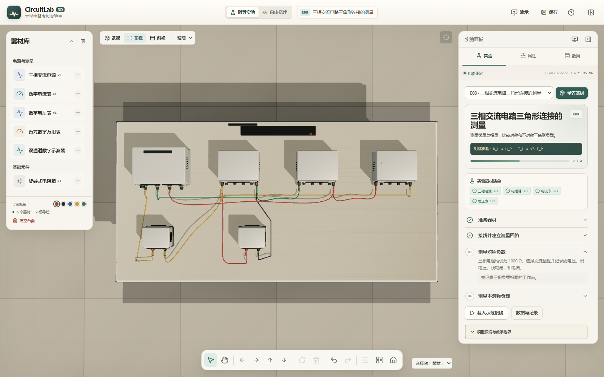
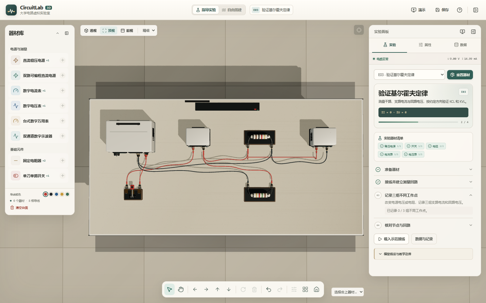

# v0.4.1 器材间距与走线检查

## 调整

八项课程的预设不再沿用窄实验桌的紧凑摆放。三相源与三只负载按相序并排，测量仪表置于前方；伏安和基尔霍夫将开关、支路元件的端子朝向接线区。其他课程和旧模板也扩大间距。

示范线按电气分组着色，A 黄、B 绿、C 红、N 蓝，电压表使用红黑表笔。颜色不参与求解；三角形示范中同一电位节点改为就近引出，串联电流表仍测量 A 线电流。

整组路径先安排短跳线，再安排主回路和测量线；候选路线比较长度、交叉、贴线和急弯，并逐一检查完整曲线与所有仪器包围盒。保留桌面与上方避障回退，器材移动或旋转后重新计算。减少了重复的直达路线计算；不把软件渲染测试当成硬件帧率验证。

底部“整理台面”供已有课程工程使用，只调整匹配器材的姿态和示范线颜色，不改其端口连接、参数、求解结果、参考点、测量记录或采集状态；支持撤销和重做。额外器材占据目标位置时停止整理并提示，避免覆盖学生摆放的器材。自由搭建中没有课程器材 ID 的工程不会套用预设。

## 实际验证

Windows Chrome / SwiftShader，桌面 1600×1000，窄屏 390×844。Browser plugin not available，沿用项目的 Playwright 运行时。八项课程分别检查俯视、透视、全部导线渲染、真实网格抽样与控制台错误。

以下间距为程序定义的旋转占地包络之间的最短平面距离，包含操作余量；不是实测设备尺寸。

| 课程 | 最小间距 |
| --- | --- |
| 伏安特性 | 29 cm |
| 电位与电位图 | 25 cm |
| 基尔霍夫 | 29 cm |
| 叠加与齐次 | 22 cm |
| 戴维南 | 25 cm |
| 最大功率 | 25 cm |
| 三相星形 | 16.5 cm |
| 三相三角形 | 22 cm |

- `npm run check`：类型检查、14 个文件 / 156 项测试、生产构建通过。新增验证覆盖间距、完整曲线与端点、相色、整理后的数据保留与撤销、额外器材阻挡。
- `npm run test:e2e:wires`：十三组、99 根实际导线网格抽样通过；真实鼠标移动第三件器材、键盘旋转、端口受阻提示与恢复通过，电气读数保持。
- 旧工程整理：载入原来的三角形摆放与原端口接线，电源设为 36 V 并记录一次；实际点击整理、撤销、重做，参数、端口连接、已求解读数和测量记录逐项一致。390 px 下整理按钮可操作，无横向页面溢出。
- 最终回归中发现遮挡夹具继承了课程的开关朝向；将该夹具固定为独立姿态后完整重跑通过，保留移动/旋转导致路径变化及网格避障断言，未删减检查。
- 首次远端旋钮回归仍断言电源位于旧版固定坐标；调整为捕获操作前的位置并比较操作后的实际位置，继续验证调压不能移动器材。该次失败不计为通过，最终远端状态以最新提交为准。

[八课机器记录](media/v0.4.1-layout-evidence.json) · [99 根线记录](media/v0.4.1-wire-evidence.json)

## 边界

交叉与贴线属于视觉代价，不是通用的线材动力学或线与线碰撞求解。任意拥挤布局仍可能需要人工移动器材；本轮抽样不能证明所有布局都无穿模。仿真范围沿用 v0.4，未新增电学元件模型或改变仪表内阻。线上发布与远端检查状态以当前 main 的 Actions 为准。
