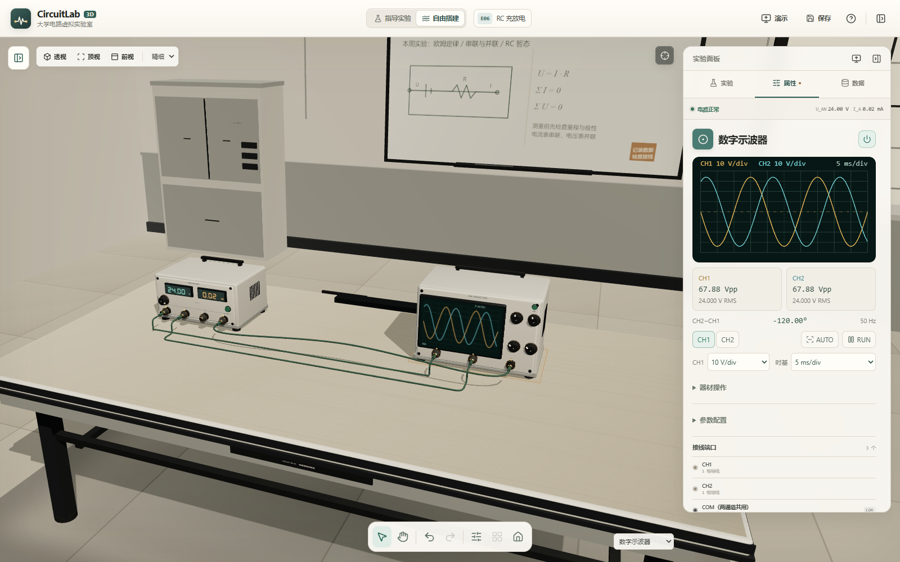
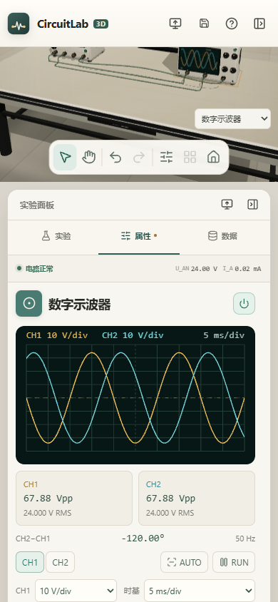

# v0.5.0 仪器属性与操作栏

点击器材后，属性面板首先显示该器材的实时屏幕，再展开详细参数。底部保留用户要求的控制台入口。

## 实现范围

- 示波器：两通道真实电压波形、Vpp/RMS、相位差、档位、时基、AUTO 和 RUN/HOLD。侧栏、完整控制台与三维屏幕使用同一份采集状态。直流画恒定电平，交流由求解所得 RMS 相量恢复，暂态只画已经采到的点。
- 万用表与电流/电压表：直接显示读数和测量模式；关闭、未接线、无效接线与超量程分别处理。电流表使用电流读数，不再将分流器端电压当主读数。
- 电源：双路电源显示实际 V/I 与 CV/CC/OFF；原直流源显示实际 V/I；三相源显示实际相量与 A 相端电压、线电流。
- 电容：显示实际端电压与已有采样曲线；开始暂态后保持在属性页，暂停保留采样。
- 操作栏：七个按钮，依次为选择、手形平移、撤销、重做、控制台、整理台面、视角复位。四向平移按钮移除，旋转与删除位于属性中的“器材操作”。
- 修复三维点击失选：面板收起时，器材按下会打开面板；此前相机投影随即移动，松开时被识别为点空。现在操作期间冻结布局投影，并记录本次按下是否实际选中器材，避免视图偏移将真实命中误判为空白；下一次真实点击空白仍取消选择。

没有改变器材三维模型、电路求解模型、存档格式或测量记录结构。原数据页、CSV 与大屏继续使用。

## 参考核对

| 用户参考 | 本次对应行为 |
| --- | --- |
| 示波器侧栏中的波形、两通道指标与档位 | 属性顶部直接显示紧凑波形与必要控制；更详细参数折叠 |
| 万用表侧栏中的液晶屏和模式 | 显示实时读数与五种功能按钮 |
| 冗余方向按钮与控制台入口 | 去掉四向按钮，保留控制台；旋转/删除移入属性 |

## 验证边界

Browser 插件未提供，使用项目已有 Playwright 与独立 Chrome/SwiftShader 上下文；不操作用户浏览器存档。

已通过 `npm run check`：15 个文件、162 项测试，类型检查及生产构建通过。新增 6 项读数/AUTO 验证，覆盖电流表单位、未接入、关闭、超量程、带电电阻挡、正负直流与交流峰值。

补充浏览器实测覆盖 1600×1000、1024×768 和 390×844：实际点击三维示波器自动显示波形、窗口无横向溢出；电流表 AC/DC 切换；电源关闭；属性中旋转/删除与撤销。RC 曲线的 41 个点已逐点对照实际样本，未插入模拟装饰曲线。该轮控制台无应用错误。

并行运行两份本机 SwiftShader 检查曾发生截图超时；没有将超时计为通过。改用单浏览器串行完成上述检查。实体 GPU 性能结论不由软件渲染结果推出。

| 本轮本机命令 | 实际结果 |
| --- | --- |
| `npm run check` | 162 项测试、类型检查、生产构建通过 |
| `npm run test:e2e` | 实际旋钮、开关、拖线、旧实验、存档恢复与 CSV 通过 |
| `npm run test:e2e:advanced` | 八项课程、记录与恢复、相量、CSV 和 390 px 通过 |
| `npm run test:e2e:wires` | 13 组场景、99 根渲染导线，以及移动/旋转遮挡物检查通过 |
| `npm run test:e2e:instruments` | 投影修复后串行通过；覆盖关闭侧栏后的实际点击、PSU/DMM/示波器、AUTO、HOLD、76 点真实 RC 采样、10 条记录与大屏/CSV |

前三组浏览器命令在最后的相机投影修复前执行；最终提交还会由 CI 对全部四组重新执行。当前完整仪器回归中控制台错误为零。新增点击用例先等取景完成，并分别断言按下确实命中器材、松开后保持选择和器材位置未改变。

首次 Linux CI 的交互、课程和导线三组通过，仪器组在新增实际点击处失败，发布被阻止。失败截图与定位日志显示坐标相差 201 px（侧栏投影偏移）；因此在屏幕定位前显式同步相机投影与世界矩阵，再由完整 CI 重验。不将首次 CI 记为通过。

第二次 CI 仍出现相同偏移，矩阵同步未单独解决问题。移除了依赖下一动画帧才调整布局投影的做法，改为同步更新；使用本次 pointerdown 的真实命中状态处理随后的 click，另加下一次空白点击能取消选择的断言。

没有新增硬件带宽、ADC、完整触发系统或通用 SPICE 仿真。AUTO 只选择现有真实档位，超过最大档位可显示的幅度仍会裁切；暂态不估算尚无充分采样依据的 RMS/Vpp。未在实体 GPU、Safari 或触屏硬件上验证。

